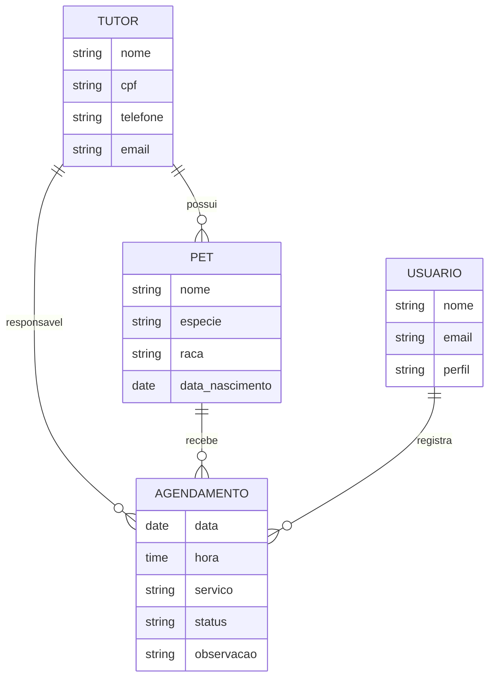

# VetCare - Sistema de Gestão para Clínica Veterinária

Sistema web para gestão de clínica veterinária, com autenticação de usuários, cadastro de tutores, pets e agendamentos de consultas e procedimentos.

## Visão geral

O projeto foi desenvolvido em PHP com arquitetura MVC artesanal, focado em organização de código, segurança básica de aplicação e gestão operacional de uma clínica veterinária.

Ele permite:

- autenticar usuários com sessão e expiração automática;
- gerenciar tutores e pets;
- registrar e listar agendamentos por data;
- manter um painel principal com indicadores do sistema;
- proteger rotas e ações contra acessos não autenticados;
- aplicar medidas essenciais de segurança como CSRF, cookies seguros, hash de senhas e criptografia de dados sensíveis.

## Funcionalidades

### Autenticação e segurança
- Login com e-mail e senha;
- controle de sessão por usuário;
- expiração automática após inatividade;
- logout seguro com destruição da sessão;
- proteção de rotas por guard de autenticação;
- validação de token CSRF em ações sensíveis;
- uso de `password_verify()` para comparação de senhas;
- criptografia AES-256-GCM para CPF, quando sensível.

### Gestão de tutores
- cadastro de tutores;
- listagem com visualização dos dados cadastrados;
- edição de informações do responsável pelo pet;
- suporte ao armazenamento de CPF cifrado, respeitando a LGPD.

### Gestão de pets
- cadastro de pets vinculados a um tutor;
- relacionamento entre tutor e animal;
- listagem dos pets registrados.

### Agendamentos
- criação de agendamentos com data, hora, serviço, status e observação;
- listagem ordenada por data e horário;
- atualização de data/horário do agendamento.

### Dashboard
- painel principal com nome do usuário logado;
- indicadores de quantidade de tutores e pets;
- listagem dos agendamentos mais recentes.

## Tecnologias utilizadas

- PHP 8.x
- PostgreSQL
- PDO com prepared statements
- HTML + PHP
- MVC artesanal
- Sessões e cookies HTTP
- Criptografia OpenSSL

## Estrutura do projeto

```text
SAEP 2º Semestre 2026/
├── README.md
├── sistema/
│   ├── config/
│   │   └── database.ini
│   ├── public/
│   │   └── index.php
│   ├── schema.sql
│   └── src/
│       ├── Controller/
│       │   ├── AgendamentoController.php
│       │   ├── AuthController.php
│       │   ├── Controller.php
│       │   ├── HomeController.php
│       │   ├── PetController.php
│       │   └── TutorController.php
│       ├── Core/
│       │   ├── AuthGuard.php
│       │   ├── ConexaoBanco.php
│       │   ├── Criptografia.php
│       │   └── Roteador.php
│       ├── Model/
│       │   ├── Agendamento.php
│       │   ├── Pet.php
│       │   ├── Tutor.php
│       │   └── Usuario.php
│       └── Views/
│           ├── agendamentos/
│           ├── auth/
│           ├── home/
│           ├── layout/
│           ├── pets/
│           └── tutores/
└── ...
```

## Fluxo principal de rotas

O roteador centraliza a navegação da aplicação:

- `GET /login` — tela de login
- `POST /login` — autenticação do usuário
- `POST /logout` — encerramento da sessão
- `GET /` — dashboard principal
- `GET /tutores` — listagem de tutores
- `GET /tutores/novo` — cadastro de tutor
- `GET /tutores/editar` — edição de tutor
- `GET /pets` — listagem de pets
- `GET /pets/novo` — cadastro de pet
- `GET /agendamentos` — listagem de agendamentos
- `GET /agendamentos/novo` — cadastro de agendamento
- `GET /agendamentos/editar-data` — edição de data do agendamento

## Requisitos

- PHP 8.x ou superior
- PostgreSQL
- extensão `pdo_pgsql` habilitada
- extensão `openssl` habilitada
- servidor web ou execução local com PHP built-in server

## Configuração do banco

1. Crie o banco PostgreSQL:

```bash
createdb saep_prova
```

2. Ajuste as credenciais em `sistema/config/database.ini`:

```ini
[database]
db_driver = pgsql
db_host = 127.0.0.1
db_port = 5432
db_name = saep_prova
db_user = postgres
db_pass = postgres
```

3. Importe o script SQL:

```bash
psql -d saep_prova -f sistema/schema.sql
```

> O arquivo `schema.sql` também inclui registros iniciais de usuários, tutores, pets e agendamentos para facilitar a validação do sistema.

## Execução local

Na raiz do projeto, execute:

```bash
php -S 0.0.0.0:8000 -t sistema/public
```

Em seguida, acesse:

```text
http://localhost:8000/login
```

## Usuários iniciais

Use esta conta demonstrativa para entrar:

- **E-mail:** `camila.vet@sisvet.com`
- **Senha:** `VetCare@2026`

Essa senha é destinada apenas ao ambiente local de demonstração. Altere-a antes de usar o sistema em qualquer ambiente compartilhado ou de produção.

> Se o banco já tinha o usuário da Camila antes desta configuração, importar novamente o schema não altera a senha existente (`ON CONFLICT DO NOTHING`). Nesse caso, atualize a senha pelo procedimento indicado no projeto ou recrie o banco para carregar os dados iniciais atualizados.

## Segurança aplicada

O projeto procura seguir boas práticas de segurança, incluindo:

- `PDO` com prepared statements;
- `password_hash()` e `password_verify()`;
- `session.use_strict_mode` e cookies com `HttpOnly` e `SameSite=Lax`;
- validação de CSRF para ações de login/logout;
- expiração de sessão por inatividade;
- criptografia de dados sensíveis com AES-256-GCM;
- uso de variáveis de ambiente para segredos e chaves de aplicação.

## Modelo de dados

### MER — Modelo Entidade-Relacionamento

O MER apresenta as entidades do domínio e como elas se relacionam, sem detalhar os tipos físicos usados no banco:



### DER — Diagrama Entidade-Relacionamento

O DER detalha as tabelas, atributos e chaves implementados em `sistema/schema.sql`:

```mermaid
erDiagram
    usuarios {
        int id PK
        varchar nome
        varchar email UK
        varchar senha_hash
        varchar perfil
        timestamp criado_em
    }

    tutores {
        int id PK
        varchar nome
        varchar cpf_criptografado
        varchar telefone
        varchar email
        timestamp criado_em
    }

    pets {
        int id PK
        int tutor_id FK
        varchar nome
        varchar especie
        varchar raca
        date data_nascimento
        timestamp cadastrado_em
    }

    agendamentos {
        int id PK
        int tutor_id FK
        int pet_id FK
        int usuario_id FK
        date data_agendamento
        time hora_agendamento
        varchar servico
        varchar status
        text observacao
        timestamp criado_em
    }

    tutores ||--o{ pets : possui
    tutores ||--o{ agendamentos : responsavel
    pets ||--o{ agendamentos : paciente
    usuarios ||--o{ agendamentos : registra
```



Cada pet pertence a um tutor e cada agendamento está associado a um tutor, a um pet e ao usuário que o registrou. O schema também usa uma chave estrangeira composta entre `(pet_id, tutor_id)` e `(id, tutor_id)` para garantir que o pet selecionado pertence ao tutor informado no agendamento. `UK` indica valor único e `PK`/`FK` indicam chaves primárias/estrangeiras.

## Observações

Este projeto foi pensado como uma aplicação acadêmica e prática para gestão veterinária, com foco em responsabilidades claras entre camadas, controle de acesso e organização do código em MVC.

## Licença

Projeto desenvolvido para fins de estudo e apresentação da avaliação SAEP.
